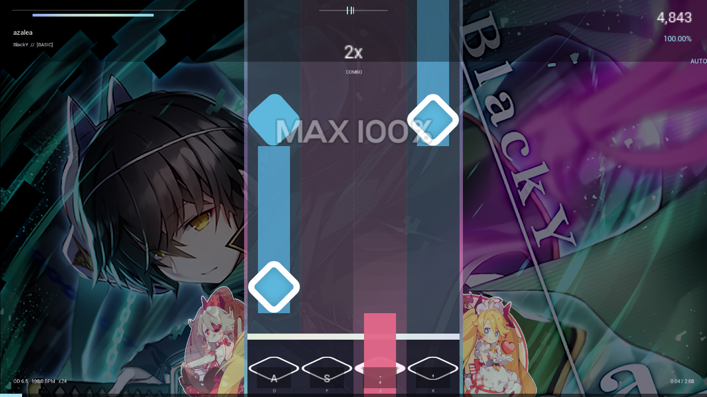

# RHYTHM ECHO

> 用 Unreal Engine 5.7 + C++ 从零重写的一个 **osu!mania 4K** 下落式音游。
> 直接读取 osu! 的 `.osu` 谱面文件，复刻 osu!mania 的判定窗口、ScoreV1 计分与血条，界面用 Canvas 全部手绘。



<sub>截图中的背景图与音效皮肤来自作者本机的 osu! 安装，**未包含在本仓库内**（原因见 [版权与素材](#版权与素材)）。仓库只有代码和文档，跑起来需要自己导入谱面。</sub>

---

## 目录

- [这是什么](#这是什么)
- [功能特性](#功能特性)
- [操作方式](#操作方式)
- [构建与运行](#构建与运行)
- [导入自己的谱面](#导入自己的谱面)
- [判定、计分与血量](#判定计分与血量)
- [命令行与自动化](#命令行与自动化)
- [项目结构](#项目结构)
- [实现要点](#实现要点)
- [已知限制](#已知限制)
- [版权与素材](#版权与素材)

---

## 这是什么

一个**学习性质的重制项目**：没有使用 Unity 的 osu! 客户端源码，也没有使用任何 osu! 的代码或资源文件，而是从"玩法"出发，在 UE5 上用 C++ 重新实现了一套 4K mania：

| 方面 | 做法 |
| --- | --- |
| 谱面 | 运行时用纯文本解析器读 `.osu` 文件（`Mode: 3` + `CircleSize: 4`），不依赖任何编辑器导入流程 |
| 音频 | 把源音频离线转成 44.1 kHz / 立体声 / s16le 裸 PCM，运行时流式喂给 `USoundWaveProcedural` |
| 画面 | 不建任何蓝图资产，音符、轨道、HUD、菜单全部在 `AHUD::DrawHUD` 里用 `Canvas` 的 `Tex`/`Rect`/`Label` 手绘 |
| 图片 | PNG/JPG 在运行时用 `FImageUtils::ImportBufferAsTexture2D` 从磁盘加载，所以换背景不需要重新打包 |
| 判定 | 按 osu wiki 的 mania 判定公式实现，OD 决定 GREAT/GOOD/OK/MEH 窗口，PERFECT 恒为 ±16 ms |
| 计分 | osu!mania 的 ScoreV1（base 50% + bonus 50%），满分 1,000,000 |

整个游戏只有 **约 2700 行 C++**，除了 `UE5` 本身没有第三方依赖。

## 功能特性

- **4K 下落式玩法**：普通音符 + 长条（hold），hold 的头尾分别判定
- **osu!mania 判定体系**：PERFECT / GREAT / GOOD / OK / MEH / MISS，带"早打惩罚"的 MEH 窗口
- **ScoreV1 计分**：`base` 分 + `bonus` 分双段计算，bonus 会被 miss 清零，最大值 100 / 最小值 0
- **血条**：命中回血、miss 掉血、固定的被动衰减，血量归零即失败
- **成绩结算**：分数、accuracy、最大连击、六档判定数量、评级与 CLEARED / FAILED，可重试或回选曲
- **完整流程**：主菜单 → 选曲 → 游玩 → 暂停 → 结算 → 重开
- **谱面自动扫描**：把谱面目录丢进 `Content/Rhythm/Songs/` 就会被列出，不需要改代码
- **原速音频同步**：音频从任意时间点开始播放都以字节偏移对齐，暂停/继续不跑调
- **两种键位**：`A S ; '`（osu!mania 4K 默认）和 `D F J K`
- **自动化冒烟测试**：`--self-test` 用脚本按键真打一遍并输出分步报告，`--screenshot` 直接截图

## 操作方式

| 操作 | 按键 |
| --- | --- |
| 移动选择 | `↑` `↓` / 鼠标悬停 |
| 确认 | `Enter` / `Space` / 鼠标左键 |
| 返回 / 暂停 | `Esc` |
| 打击（4K） | `A` `S` `;` `'` 或 `D` `F` `J` `K` |

## 构建与运行

**环境要求**

- Windows 10/11 x64
- Unreal Engine **5.7**（源码版或 Launcher 版均可）
- Visual Studio 2022（含 "使用 C++ 的游戏开发" 工作负载 + Windows 10/11 SDK）

**步骤**

1. 如果 `Game.uproject` 里的 `EngineAssociation` 是一个 GUID，说明它指向作者本机的引擎安装。右键 `Game.uproject` → **Switch Unreal Engine version…**，选择你本机的 UE 5.7。
2. 右键 `Game.uproject` → **Generate Visual Studio project files**。
3. 打开生成的 `Game.sln`，配置选 **Development Editor / Win64**，生成。
4. 双击 `Game.uproject` 启动编辑器，直接点 **Play** 即可游玩；也可以打包成独立的 Windows 客户端。

> 仓库里不带 `Binaries/`、`Intermediate/`、`Saved/`、`Build/` 和 `.sln`，这些都是生成物。
> 唯一需要保留的二进制是 `Content/Maps/Main.umap`——一个空关卡，它只负责承载 `RhythmGameMode`，
> 场景里的所有东西都是运行时画的。

**打包注意**

`Config/DefaultGame.ini` 里已经设置了：

```ini
UsePakFile=False
bUseIoStore=False
+DirectoriesToAlwaysStageAsNonUFS=(Path="Rhythm")
```

因为谱面、音频、背景都是运行时从磁盘读的，**不能进 pak**，这个配置必须保留，否则打包后读不到内容。

## 导入自己的谱面

本仓库**不附带任何音频、谱面、背景图或皮肤**（授权原因），所以 clone 下来直接运行会是一个空曲库。用一个脚本把本机 osu! 里的 4K 谱面导进来：

```bash
# 1) 导入整个 osu! 曲库中所有 4K 谱面（默认跳过非 4K）
python Tools/import_charts.py --osu-root "C:/Users/<you>/AppData/Local/osu!"

# 2) 或者只导入指定的几个谱面目录
python Tools/import_charts.py --song "C:/.../Songs/2073289 BlackY - azalea"

# 3) 顺便把 osu! 皮肤的打击音效复制过来（可选）
python Tools/import_charts.py --skin "C:/.../osu!/Skins/[ DJMAX RESPECT ]"

# 4) 只看会导入什么，不写文件
python Tools/import_charts.py --osu-root "C:/.../osu!" --dry-run
```

脚本需要 **Python 3.8+** 和 **ffmpeg**（在 `PATH` 里，或 `--ffmpeg <路径>`），它会把每首先转换成游戏要的格式：

```
Content/Rhythm/Songs/<Artist - Title>/
├── chart.osu      # 原样复制
├── audio.pcm      # ffmpeg 转成 44100 Hz / 2ch / s16le 裸 PCM
├── bg.png|jpg     # 从 [Events] 里取背景，没有就找目录里第一张图
└── meta.json      # 给人看的旁注（游戏不读）
```

**手动准备的格式**（如果你想自己写一个）：

| 文件 | 要求 |
| --- | --- |
| `chart.osu` | osu! 谱面，`[General]` 里 `Mode: 3`、`[Difficulty]` 里 `CircleSize: 4` |
| `audio.pcm` | 44100 Hz、2 声道、16-bit 小端裸 PCM（没有 WAV 头） |
| `bg.*` | `.png` / `.jpg`，可选，缺失就是纯色背景 |
| `Skin/*.wav` | `normal-hitnormal.wav`、`normal-hitclap.wav`、`normal-hitfinish.wav`、`normal-hitwhistle.wav`、`combobreak.wav`，可选 |

转换命令（等价于脚本里做的事）：

```bash
ffmpeg -i song.ogg -f s16le -acodec pcm_s16le -ac 2 -ar 44100 audio.pcm
```

## 判定、计分与血量

完整公式（含每个常数的来源、在 osu wiki 上的依据、以及哪些是估算值）见 **[MECHANICS.md](MECHANICS.md)**，机器可读版本见 **[mechanics.json](mechanics.json)**。速查：

**判定窗口**（OD = 6.5 时，单位 ms）

| 判定 | 窗口 | 公式 |
| --- | --- | --- |
| PERFECT | ±16 | 固定，不受 OD 影响 |
| GREAT | ±44 | `trunc(64 − 3 × OD)` |
| GOOD | ±77 | `trunc(97 − 3 × OD)` |
| OK | ±107 | `trunc(127 − 3 × OD)` |
| MEH | −131 / +0 | `trunc(151 − 3 × OD)`，**只对早打生效** |

**计分（ScoreV1）**

```
unit  = 1e6 × 0.5 / 总判定数
score = unit × Σ HitValue + unit × Σ(HitBonusValue × HitBonus)
```

`HitValue`：PERFECT 320 / GREAT 300 / GOOD 200 / OK 100 / MEH 50 / MISS 0
`HitBonusValue`：32 / 32 / 16 / 8 / 4 / 0，`HitBonus` 固定 2（但 bonus 池默认 100 起步、上限 100）
`HitPunishment`：8 / 24 / 44（MISS 直接把 bonus 打回 0）

**评级**：SS = 100%，S > 95%，A > 90%，B > 80%，C > 70%，其余 D / F。

**血量**：100 起步，PERFECT +1.2、GREAT +1.0、GOOD +0.4、OK +0.1、MEH −0.5、MISS −5.0，外加每秒 `0.10 + 0.08 × HP` 的被动衰减。

**手感参数**：`ManiaSpeed = 24`（音符 720 ms 内从顶部落到判定线，约 605 ms 可见），判定线在屏幕高度 84% 处，背景亮度压到 20%（对应 `DimLevel = 80`）。

## 命令行与自动化

游戏支持启动参数（`--flag value` 和 `--flag=value` 两种写法都行）：

| 参数 | 作用 |
| --- | --- |
| `--screenshot <png>` | 自动打开曲库第一首、自动播放几秒后截图保存，然后退出 |
| `--self-test <json>` | 用脚本化的按键输入把曲库第一首从头打到尾，把成绩写成 JSON |
| `-ResX= / -ResY=` | 标准 UE 参数，指定窗口分辨率（如 `-ResX=3840 -ResY=2160` 打 4K） |

例如：

```bash
Game.exe --self-test result.json
Game.exe --screenshot shot.png -ResX=3840 -ResY=2160
```

两个自动化入口都固定加载**曲库里的第一首**（排序规则见[已知限制](#已知限制)），
所以想指定曲目，最简单的是调整 `Content/Rhythm/Songs/` 下的目录顺序/内容。

`--self-test` 走的是真实的判定流程（脚本按键，而不是判定放宽的 autoplay），输出的不是单纯成绩单，
而是一份**冒烟测试报告**：分 `move` / `act` / `hud` 三步，分别验证"轨道确实滚动且音符接近判定线"、
"确实产生了判定"、"HUD 确实画出了分数/准确率/combo/血条"，每一步带 `passed` 和明细
（命中数、各判定计数、最大连击），适合打包后做快速回归：

```json
{
  "version": 1,
  "steps": [
    {"step": "move", "passed": true,  "detail": "playfield scrolled 812 px, 12 notes approached, 9 key presses"},
    {"step": "act",  "passed": true,  "detail": "hit 12 notes: 9 perfect, 2 great, 1 good, ..."},
    {"step": "hud",  "passed": true,  "detail": "drawn: score=yes accuracy=yes combo=yes health=yes judgement=yes"}
  ]
}
```

## 项目结构

```
rhythm-echo/
├── Game.uproject
├── Config/
│   ├── DefaultEngine.ini          # 默认地图、GameMode、关掉后处理
│   ├── DefaultGame.ini            # 打包配置：内容不进 pak
│   ├── DefaultGameUserSettings.ini# 1280×720 / 60fps / 关垂直同步
│   └── DefaultInput.ini           # 输入映射、鼠标捕获策略
├── Source/
│   ├── Game.Target.cs                # 游戏 / 编辑器两个 target
│   ├── GameEditor.Target.cs
│   └── Game/
│       ├── Game.Build.cs
│       ├── GameModule.cpp            # 模块入口
│       ├── RhythmTypes.h             # FManiaNote / FRhythmChart / 解析接口
│       ├── RhythmParse.cpp           # .osu 解析、曲库扫描、磁盘图片加载
│       ├── RhythmGameMode.h/.cpp     # 状态机、判定、计分、音频、自动化
│       ├── RhythmHUD.h/.cpp          # 全部界面绘制（Canvas 手绘）
│       └── RhythmPlayerController.h/.cpp  # 输入绑定
├── Content/
│   ├── Maps/Main.umap                # 唯一的空关卡
│   └── Rhythm/                       # ← 运行时内容，不进仓库
│       ├── Songs/<曲目>/{chart.osu, audio.pcm, bg.*}
│       └── Skin/*.wav
├── Tools/
│   ├── import_charts.py              # 把 osu! 曲库导入成上面的格式
│   └── README.md
├── docs/screenshot.png
├── MECHANICS.md                      # 完整机制说明（公式 + 出处）
└── mechanics.json                    # 机制常数的机器可读版本
```

## 实现要点

**谱面解析**（`RhythmParse.cpp`）
纯文本扫描，按 `[Section]` 分段。只接受 `Mode == 3` 且 `CircleSize == 4` 的谱面；横坐标换算成轨道号用 `lane = clamp(floor(x × 4 / 512))`；长条用 `F[5]` 冒号前的结束时间。背景从 `[Events]` 里 `0,0,"bg.jpg"` 这类行取，取不到就扫目录里的 `bg.*`。整个曲库扫描只认 `<SongsDir>/<目录>/chart.osu` 这一种布局，所以复制顺序无关紧要。

**音频**（`RhythmGameMode::StartAudio`）
把 `audio.pcm` 整个读进内存（`TArray<uint8>`），算出字节偏移后创建 `USoundWaveProcedural`，先塞 1 秒数据，之后在 `Tick` 里保持在 0.5 秒以上的预读量。暂停时 `StopAudio()` 并把播放位置记成毫秒，继续时按字节偏移重新开始——因为是无损的裸数据，反复暂停也不会累积漂移。

**渲染**（`RhythmHUD.cpp`）
没有 UMG，没有 Widget，全部是 `DrawHUD` 里的立即模式绘制：一个 `Tex()` 画图（带中心旋转，用于音符）、一个 `Rect()` 画纯色块、一个 `Label()` 画文字（用 `GEngine->GetLargeFont()` 缩放）。四个界面（菜单 / 选曲 / 游玩 / 结算）就是四组绘制函数，按钮命中测试用屏幕矩形判断。

**时间基准**（`RhythmGameMode::UpdateAudio`）
用音频的"已消费字节数 ÷ 每秒字节数"作为游戏时钟，而不是 `DeltaSeconds` 累加，所以音符位置和声音永远同源，不会因为帧率抖动而漂移。

## 已知限制

- 只支持 **4K**；5K/6K/7K 需要改 `RhythmTypes.h` 的结构和 HUD 的绘制布局
- 只支持 `normal` 打击音，没有实现 `soft`/`drum` 音色组
- 没有实现 osu! 的 `Storyboard`、`.osz` 直接读取、谱面在线下载
- 不支持 mod（DT/HT/HR 等），`ManiaSpeed` 是写死的，没有做选项界面
- 曲库排序里保留了一份开发时期的目录名优先级表（`azalea` / `psycho_heroes` / …），
  表外的曲目按曲名排序；`--self-test` 等自动化入口固定用排第一的那首
- 判定窗口的 OD 公式按 osu wiki 实现，但 MEH 的"早打才判"是从客户端行为反推的
- 结算界面的评级和 combo 颜色是近似复刻，不是逐像素还原

## 版权与素材

**本仓库只包含作者自己写的 C++ 代码、配置和文档。**

以下内容**不在**仓库里，也**不会被**上传：

- 音频（来自 osu! 曲库，版权归各曲目原作者与厂牌）
- 谱面 `.osu`（版权归谱面作者）
- 背景图（版权归插画作者/厂牌）
- 皮肤素材（DJMAX RESPECT 皮肤，版权归 Neowiz / DJMAX）
- 任何 osu! 或 DJMAX 的商标、logo、字体

它们来自作者本机安装的 osu! stable 客户端的曲库，**仅供个人本地学习使用**，不得再分发。`Tools/import_charts.py` 是给使用者在自己机器上做同样的本地导入用的，脚本本身不附带任何内容。

**关于 osu!**：本项目是一个独立实现，与 osu! 官方无关，没有使用 osu! 的代码，也没有复制其名称或 logo。谱面解析遵循公开的 `.osu` 文件格式（osu wiki）。如果你想分发自己的关卡，请使用你有权分发（或自己创作）的音频与图像。

## 致谢

- **[osu!](https://osu.ppy.sh/)** — `.osu` 文件格式与 osu!mania 的判定/计分规则文档（osu wiki）
- **Unreal Engine 5.7** — 引擎本体

## 许可

代码以 **MIT** 许可发布 —— 详见 [LICENSE](LICENSE)。

注意：MIT 只覆盖本仓库中的代码与文档，**不覆盖**你本地导入的音频、谱面、背景或皮肤素材。
